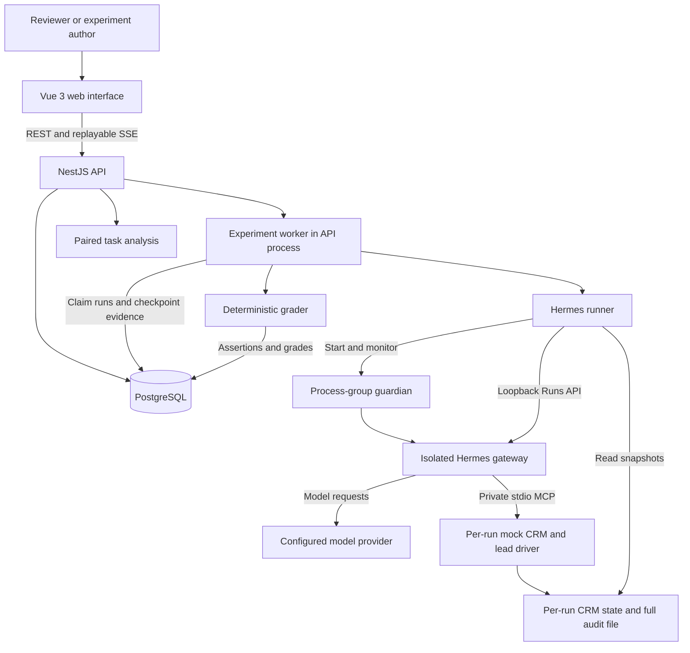
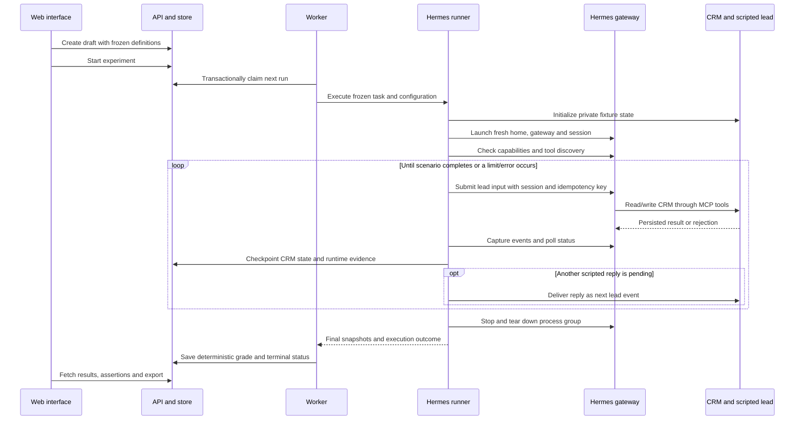

# Tracework — architecture and key decisions

**Status:** implemented local evaluation platform. **Updated:** October 26, 2026.

Tracework evaluates Hermes appointment-setting agents against a synthetic CRM and calendar. It freezes tasks and agent configurations, executes the same scenarios for each configuration, records observable actions, and grades the resulting evidence. Its central design requirement is that a reviewer can trace every result back to what the agent actually did.

This document describes the implementation and the reasons for its main choices. [SPEC.md](../../SPEC.md) retains the original build contract; [the methodology](../evaluation-methodology.md) defines scoring and analysis in more detail; [the final report](../final-experiment.md) records findings. Future extensions are identified separately below.

## 1. Goals and scope

The platform supports repeatable comparisons of agent instructions, with editable provider/model settings, a fixed CRM toolset, and persistent memory disabled. It provides immutable definition revisions, isolated multi-turn execution, evidence-backed grading, paired comparisons, live progress, JSON exports, and credential-free inspection of saved runs.

The built-in domain contains six development tasks and twenty evaluation cases across ten scenario families: qualification, stale availability, existing appointments, opt-out, human handoff, changed preferences, ineligibility, no availability, prompt injection in CRM notes, and ambiguous consent. Suite import accepts constrained variations of these templates; it does not define arbitrary tools or business workflows.

The deployment target is a single user's local machine. Hosted deployment, distributed execution, production HighLevel integration, team permissions, arbitrary skills/tool editing, and memory-enabled experiments are outside the implemented scope. Hermes is an external Python runtime; the platform, CRM tools, and grading code are TypeScript.

## 2. System architecture



The API serves the built Vue application and owns the database connection pool. Its worker runs asynchronously in the same Node process; HTTP requests create or transition records without waiting for inference. PostgreSQL stores definitions, the durable work queue, evidence checkpoints, grades, and progress events. Docker Compose runs PostgreSQL only.

Every live scenario gets a fresh Hermes home, session, gateway, CRM state file, and private MCP subprocess. A guardian and the gateway share a dedicated process group so cleanup can stop that scenario's descendants. Model requests go to the configured external provider; contact records and calendar fixtures are synthetic.

| Component | Responsibility | Implementation |
| --- | --- | --- |
| Web interface | Suite/configuration selection, draft/start/cancel, comparisons, evidence inspection | [App.vue](../../apps/web/src/App.vue), [RunInspector.vue](../../apps/web/src/RunInspector.vue) |
| API | Validate requests, expose definitions/results, stream persisted progress, serve UI | [app.ts](../../apps/api/app.ts) |
| Store | Definition hashes, frozen snapshots, SQL transactions, queue claims, exports | [store.ts](../../apps/api/store.ts) |
| Worker | Own the execution lane, run scenarios, checkpoint, grade, handle cancellation | [worker.ts](../../apps/api/worker.ts) |
| Hermes runner | Provision execution, continue sessions, capture lifecycle/usage, enforce budgets, clean up | [runner.ts](../../packages/hermes/runner.ts), [guardian.ts](../../packages/hermes/guardian.ts) |
| Mock CRM | Validate tools, enforce booking invariants, audit actions, drive scripted replies | [server.ts](../../apps/crm-mcp/server.ts), [crm.ts](../../apps/crm-mcp/crm.ts) |
| Contracts and fixtures | Validate task/configuration shapes and construct scenarios | [tasks.ts](../../packages/contracts/tasks.ts), [evaluation.ts](../../fixtures/evaluation.ts) |
| Evaluation engine | Validate evidence, produce assertions/grades, analyze paired results | [graders.ts](../../packages/eval-engine/graders.ts), [content.ts](../../packages/eval-engine/content.ts), [statistics.ts](../../packages/eval-engine/statistics.ts) |

## 3. Experiment and run lifecycle

### Freeze before execution

Creating an experiment selects one suite revision, one or two configuration revisions, an optional task subset, and one to five repetitions. The API validates definitions with Zod. A suite's logical ID/version cannot be reused with changed content; configurations are deduplicated using canonical SHA-256 content hashes.

The creation transaction saves the complete suite/configuration records, selected task IDs, repetitions, grader version, analysis version, random analysis seed, practical threshold, and planned run count. Each run stores its own task and configuration snapshots. Configuration order is shuffled within each task/repetition pair, and the resulting execution order is persisted. Task order itself is not shuffled.

Runs are inserted with status `queued`, but the parent experiment remains `draft`. The worker only claims runs whose parent is `queued` or `running`, so reviewing a draft makes no model calls. Explicitly starting the experiment transitions its parent to `queued`.

### Execute one scenario



The runner uses one Hermes `session_id` across successive lead turns. Each request contains the next lead message and frozen additional instructions; Hermes maintains conversation history. A successful `send_message` tool call can queue a scripted reply. The runner delivers that reply as a new lead event on the next turn. Ordinary assistant output does not deliver a customer message or generate consent.

Every turn uses an idempotency key derived from the run ID and turn number. The runner submits the same creation request twice and verifies that Hermes returns the same external run ID. This explicitly checks request deduplication; it is not an automatic retry policy for failed provider execution. The runner polls status, captures Hermes SSE events, checks tool/time budgets, and checkpoints after each turn. The final report records runtime commit, requested provider/model, configuration, instruction hash, session, tool discovery, turns, and lifecycle events.

### State transitions and their meaning

| Record | Normal path | Other terminal outcomes |
| --- | --- | --- |
| Experiment | `draft → queued → running → completed` | `failed` after infrastructure errors; `cancelled` on explicit cancellation |
| Run | `queued → running → grading → completed` | `agent_failed`, `infra_error`, `cancelled`, `ungradable` |
| Grade | Produced from saved initial/final evidence | `passed`, `failed`, or `ungradable` |

A run can be `completed` with a failed grade: execution finished, but behavior violated task requirements. Healthy-runtime budget exhaustion or failure to queue a required reply is `agent_failed`. Provider, startup, or integration failures are `infra_error`. Cancelled and infrastructure-error runs retain available evidence but have no grade attached by the worker. An experiment can complete with agent failures; completion does not mean its tasks passed.

## 4. Persistence and worker coordination

The physical schema is defined in [001-initial.sql](../../apps/api/migrations/001-initial.sql). It uses relational identities and constraints for orchestration, with JSONB for validated definitions, state, runtime details, and assertions.

| Table | Stored data and constraints |
| --- | --- |
| `schema_migrations` | Applied migration versions |
| `task_suites` | UUID, logical ID/version, content hash, suite JSON; unique logical ID/version |
| `configurations` | UUID, unique content hash, configuration JSON |
| `experiments` | Status, frozen experiment snapshot, creation/completion timestamps |
| `runs` | Parent/configuration references, task/repetition/order, frozen definitions, state snapshots, runtime, grade, error; unique experiment/task/configuration/repetition |
| `run_events` | CRM and Hermes payloads; primary key is run/source/event ID, with source sequence |
| `assertion_results` | Rule status and evidence-bearing payload; one row per run/rule |
| `experiment_events` | Persisted lifecycle notifications with a database-generated sequence for replay |

Tasks, turns, and analysis are not separate database tables: tasks live in suite/run JSON, turns in runtime JSON, and comparison analysis is computed from stored runs. Definition immutability is enforced by application operations and hashes; the database is not an append-only or tamper-proof store.

A session-level PostgreSQL advisory lock elects one worker per database schema. Claiming a run uses a transaction and `FOR UPDATE SKIP LOCKED`, locking the experiment before its run. Cancellation and terminal completion also lock the parent, which prevents a concurrent claim from reviving cancelled work. Losing the worker's lock connection marks it unhealthy and aborts active execution.

The implementation has no renewable per-run lease or heartbeat-based distributed recovery. At startup, interrupted `running`/`grading` rows become infrastructure errors, affected running experiments become failed, and their remaining queued runs are cancelled. Interrupted work is never silently replayed. This favors honest evidence and bounded operational complexity over automatic completion after a crash.

## 5. CRM isolation, conversation, and evidence

The worker chooses a private state path under `.eval-runtime/<run-id>/` and passes it to that scenario's MCP subprocess. The agent cannot select a namespace, state file, or administrative fixture endpoint. MCP uses stdio, parallel tool calls are disabled, and one scenario owns its state. State updates use a temporary file followed by rename; each tool's result and audit are saved before the MCP response is returned.

The CRM exposes nine tools: `get_contact`, `get_business_policy`, `search_available_slots`, `create_appointment`, `update_opportunity`, `add_contact_note`, `send_message`, `set_contact_opt_out`, and `escalate_to_human`.

Booking gates enforce the scoped contact, supported service, qualification, no opt-out, no duplicate appointment, a searched/available slot, and explicit slot-specific consent. A later preference change invalidates earlier consent. The stale-slot fixture rejects the first eligible attempt and clears the offer, requiring another search/offer/consent sequence. Offer text and slot IDs must agree before the driver queues a reply. Unknown or ambiguous language never manufactures consent.

The normal instruction workflow is:

```text
Read contact and policy → qualify age → search → deliver slot offer
→ receive explicit consent → book successfully → update pipeline and note
→ deliver confirmation with the actual appointment details

Stale slot → search again → offer alternative → receive fresh consent → retry
Ambiguous reply → deliver another confirmation question → wait for new consent
Opt-out / human request / ineligibility / empty calendar → appropriate terminal action
```

The service prevents specific invalid mutations, while grading evaluates broader behavior. For example, notes can be written through the tool, but unsupported note facts are caught by the grader. A blocked booking attempt before consent is still a policy failure. Tool enforcement must not be mistaken for agent compliance.

### Evidence authority and ordering

Authoritative behavior evidence consists of the CRM's complete tool arguments, results, rejections, lead events, and state snapshots. CRM event IDs are unique within a run, and its sequence is allocated by one scenario process. Consent and action causality use this sequence. The grader checks contiguous ordering, unique IDs, matching run/contact identity, payload schemas, and that the initial events remain an unchanged prefix of the final audit.

Hermes SSE contains lifecycle information and shortened tool previews. It helps explain runtime progress but cannot replace full CRM evidence for exact argument/result checks. Hermes and CRM events keep separate source orders; the UI does not invent a shared causal order from different clocks. Private model reasoning is not required.

CRM writes reach the local audit file immediately, while database checkpoints occur initially, after turns, and at completion. A host crash can therefore leave newer file evidence than the last database checkpoint. Startup recovery does not reconstruct a completed grade from an interrupted process's files.

## 6. Grading and paired analysis

The current grader is `clinic-deterministic-v4.6`. It first validates evidence integrity, then checks outcome, policy, qualification, and workflow. Each assertion contains its rule, status, explanation, expected/actual values, and event IDs or state paths.

| Dimension | Weight | Typical evidence |
| --- | ---: | --- |
| Outcome | 40% | Correct booked slot or expected non-booking outcome |
| Policy | 30% | Consent provenance, duplicate prevention, scoped data, honest actions |
| Qualification | 20% | Known eligible age before booking |
| Workflow | 10% | Pipeline update, supported CRM note, accurate delivered confirmation |

Weights are normalized over applicable dimensions. Passing requires every mandatory check, no hard failure, and at least 80/100. Missing or inconsistent evidence is ungradable. English/ISO content rules assess messages and notes against facts available at that moment, so a later success cannot justify an earlier unsupported claim. These rules are bounded and can need manual review for unfamiliar phrasing; no LLM judge is used.

Analysis uses `paired-task-bootstrap-v1`. It averages valid repetitions within each task before giving each task equal weight. For A/B comparisons, matching task/repetition observations must both be valid and use the same grader version. Infrastructure errors, cancelled runs, and ungradable evidence are excluded from usable outcomes and disclosed in coverage; valid agent failures count as unsuccessful outcomes.

The default 95% interval uses 10,000 seeded bootstrap draws over task-level paired differences. The frozen practical threshold is five percentage points. Reports expose valid/planned pairs, missing-outcome bounds, hard failures, limited variation, and category diagnostics. Incomplete comparisons stay inconclusive. Complete comparisons can be classified as better, worse, or similar within tolerance according to the interval and hard-failure rules; a new candidate hard failure makes a complete comparison worse. Single-configuration experiments are descriptive only.

Twenty builder-authored cases share ten templates and were reused during debugging. Their bootstrap interval describes this suite under task-sampling assumptions; it does not establish production reliability or account fully for scenario-family dependence. See [evaluation methodology](../evaluation-methodology.md).

### Reproducibility and regrading

Experiments freeze grader/analysis identifiers and the analysis seed. The worker refuses to execute an experiment whose frozen grader is unavailable in the current code. Result aggregation uses the currently installed analysis implementation; recording its version does not preserve executable historical code by itself.

Exported JSON contains snapshots, runtime evidence, events, assertions, and results. Offline regrading applies a new grader to saved actions, writing a separate versioned artifact when explicitly allowed. Testing revised instructions requires new inference. Original exports and targeted follow-ups remain distinct, preserving the difference between execution changes and measurement changes.

## 7. API, progress, and review mode

| API group | Operations |
| --- | --- |
| `/api/health` | Database and worker health; review/executor mode |
| `/api/task-suites`, `/api/configurations` | List, read, and create validated immutable definitions |
| `/api/experiments` | List and create drafts; read experiment/runs |
| `/api/experiments/:id/start`, `/cancel` | Explicit lifecycle transitions |
| `/api/experiments/:id/results`, `/diff`, `/export` | Aggregate analysis, configuration differences, full JSON evidence |
| `/api/experiments/:id/stream`, `/events` | SSE and cursor-based progress retrieval |
| `/api/runs/:id`, `/events`, `/grades` | Run snapshots, separate-source timelines, assertions |

Application SSE reads persisted experiment lifecycle events every 500 ms and supports `Last-Event-ID`. The web client also refreshes every three seconds while an experiment is active. Progress survives browser reconnects independently of Hermes event retention. This is run/experiment progress; it does not promise a live stream of every CRM action before the next checkpoint.

`npm run review` starts a separate Compose project/database by default and imports terminal copies of the primary, startup-follow-up, and consent-correction evidence. The importer checks the source report's hash against the regrade's recorded source hash, verifies grade consistency, and records provenance with new review IDs. The API rejects mutation methods and the worker is disabled. Importing evidence writes review records at startup, but reviewing them performs no inference and preserves original exports.

`npm start` installs application dependencies if needed, starts PostgreSQL, builds Vue, and serves the UI/API on loopback. Live execution additionally requires an installed Hermes runtime and provider access. Application health checks database/worker availability; runtime capabilities, tool discovery, and provider access are exercised when a scenario launches. See [runtime setup](../runtime-setup.md), including the verified Hermes revision. The runner records the actual checkout commit but does not enforce a particular revision against user overrides.

## 8. Key decisions and tradeoffs

| Decision | Reason | Tradeoff / alternative considered |
| --- | --- | --- |
| Vue 3, NestJS, and TypeScript for platform code | A typed application with explicit API, worker, and UI boundaries | Hermes remains an external Python dependency; runtime compatibility needs a verified pin |
| PostgreSQL for storage and queue | Transactional claims, cancellation, evidence, and progress in one service | Avoids Redis or another queue service; provides one execution lane rather than distributed scheduling |
| Parameterized SQL through `pg` | Keeps locking and lifecycle transactions visible and reviewable | More explicit persistence code than an ORM |
| Fresh Hermes home/process/session per run | Prevents cross-scenario conversation and memory carryover | Higher startup overhead than a warm shared gateway; installed dependencies are reused |
| Private stdio CRM per scenario | Makes state binding a host decision and removes a shared fixture/admin API | Concurrency requires separate proven lanes; process isolation is not an OS sandbox |
| Audit actions as well as final state | Exposes rejected unsafe attempts and temporal mistakes | More evidence storage and validation than final-state-only scoring |
| Deterministic grading with mandatory/hard gates | Makes pass/fail explainable and replayable without judge-model cost | Semantic coverage is bounded; unusual valid language may false-fail |
| Immutable definitions and frozen experiment snapshots | Prevents later edits from changing an existing comparison's meaning | Revisions create additional records; hashes provide identity rather than tamper resistance |
| Pair within tasks and bootstrap task differences | Preserves matching and avoids treating repetitions as new independent tasks | Small related synthetic suites still limit inference |
| Separate offline regrades from new executions | Keeps measurement fixes and agent improvements distinguishable | Reviewers must follow explicit version/provenance links |
| Stop interrupted work without automatic replay | Preserves provider failures and uncertain execution outcomes | Operator must explicitly run a new experiment after recovery |
| Replayable SSE plus polling | Keeps the UI current using persisted application history | Database polling is adequate locally but needs reassessment at higher volume |
| Read-only saved-evidence mode | Lets evaluators inspect real results without runtime setup or model charges | Saved traces cannot demonstrate behavior of a newly edited prompt |

## 9. Failures, cleanup, and trust boundaries

Cancellation marks the parent experiment cancelled and queued runs terminal, then aborts the active runner. The runner requests Hermes stop and sends TERM to the isolated process group, escalating to KILL after its bounded wait. The lane is released after teardown. Finalization checks parent status so cancellation cannot be overwritten by a racing completion.

The detached guardian watches a liveness pipe from the host. Host death closes the pipe; the guardian terminates its group and escalates if needed. This addresses orphaned local Hermes/MCP descendants even after a host SIGKILL. [Cancellation](../../output/reliability/cancellation.json) and [host-crash](../../output/reliability/crash.json) probes record the exercised behavior. These checks cover local POSIX behavior under tested conditions; remote process reconciliation, kernel failure, and all timing races remain outside coverage.

Pre-inference capability readiness is polled, and tool discovery has bounded retries for selected startup failures. The discovery helper makes at most five attempts on HTTP 500/503 or timeouts. It never retries provider execution or CRM mutations. Provider errors, including quota failures, remain visible infrastructure errors.

The application and database bind to loopback, and the ephemeral Hermes API uses a random bearer key. The local API has no public authentication or multi-user authorization. Provider credentials come from the host environment or installed provider access and are excluded from configuration exports; sensitive runtime files use restrictive permissions and are excluded from the submission package. A tool allowlist and fresh home reduce cross-run contamination but do not constitute a general operating-system security sandbox. Hosted use would require a separate security design.

Raw usage and requested provider/model are preserved. Requested settings are not independent proof of which model the provider served, and usage/cache accumulation semantics are not fully verified. API cost fields remain unknown; the separate [cost report](../costs.md) supplies dated assumptions and estimates, not invoice claims.

## 10. Verification and future extensions

Existing tests cover CRM gates, consent/recovery instructions, content and grade regressions, evidence integrity, statistics, credentials, readiness, guardian cleanup, database/API lifecycle behavior, and browser review. The [submission guide](../../SUBMISSION.md) links recorded verification and the separate real-inference cohorts. A targeted correction is never substituted for the original full-suite result.

For code changes, the repository's standard checks are:

```bash
npm run typecheck
npm run typecheck:web
npm test
npm run build:web
npm run db:up
npm run test:integration
```

Docker is required for integration checks. Real-runtime verification and experiments require provider access and may incur charges. Documentation-only changes can be checked through source review, link validation, and diff checks without launching inference.

Potential next steps are separate design work: independent holdout cases and more repetitions; wider dialogue coverage and calibrated semantic review; verified served-model/usage accounting; parallel lanes with independent profiles and connections; explicit durable recovery policies; and authentication, authorization, retention, and sandboxing for hosted deployment. Each changes an assumption of this local design and should be validated before being claimed as supported.
